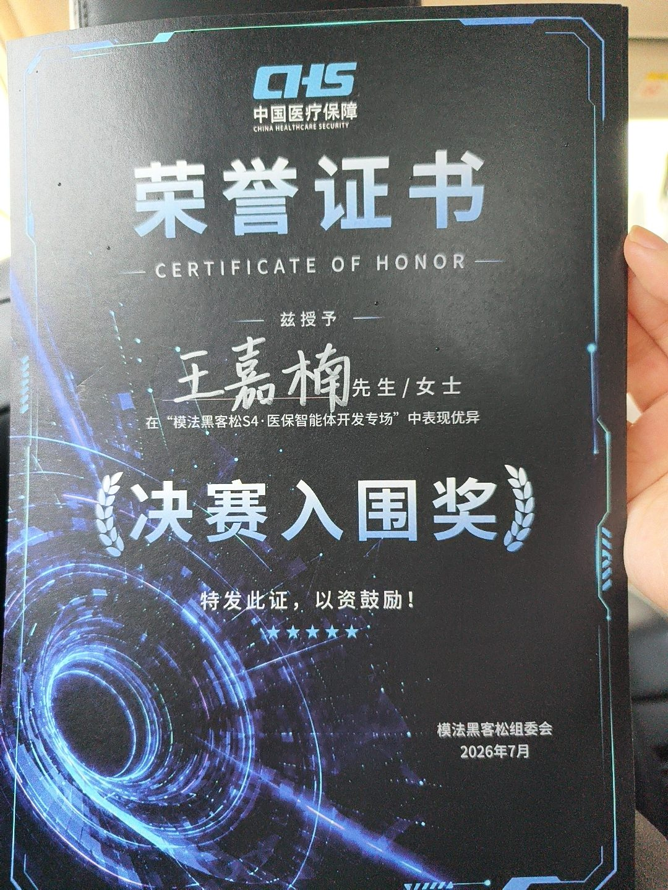

# MedGuard · 省基本医疗保险定点机构监督管理与行政执法智能体

> **模法黑客松 S4 · 医保基金监管赛道 · 决赛入围奖**（中国医疗保障主办，2026 年 7 月）
> **队长：汪蕾　队员：王嘉楠、张鹏**
> 三人团队 · 我负责 **需求分析与系统构建 · 六步研判链路设计 · 现场演示与讲解**



> 📌 证书为**个人署名**（组委会按参赛成员逐一颁发）。本项目为三人团队作品，
> 我负责需求分析与系统构建 —— 团队分工见下方「👥 团队与分工」。

---

## 📺 3 分钟演示

> 录屏文件：`./demo/medguard-demo.mp4`（或下方在线链接）
> 对应 JD 硬要求 —— *"the ability to demonstrate working systems"*。

| 时间 | 画面 | 看点 |
|:---|:---|:---|
| 0:00–0:25 | 输入一段虚构的病历/结算单 | **不是演示"界面好看"，是演示"输入不完整也敢用"** |
| 0:25–1:00 | 六步链路逐步展开 | 每一步的引用来源都在屏幕上可点开 |
| 1:00–1:40 | 法规匹配 + 判例参照展开 | ⭐ **双库驱动：每个结论都挂着法规条款和相似判例** |
| 1:40–2:20 | 关联比对触发 → 人工复核门拦下 | ⭐ **主动展示"模型不单独下结论"** |
| 2:20–3:00 | 依据链回溯 + 局限表 | **结论可复核 + 主动说边界** |

> ⚠️ 演示数据全部为**脱敏/虚构**，不含任何真实医保基金数据、参保人信息或机构内部资料。

---

## 📦 关于这个仓库 vs 团队仓库

| | 本仓库 `itr-del/med-guard` | 团队仓库 `kinoko-shelter/med-guard` |
|:---|:---|:---|
| **性质** | 📄 **项目档案与演示仓库**（公开） | 💻 **源码与运行版本**（团队维护） |
| **内容** | README · 证书 · 架构图 · 演示录屏 · 评测样例说明 | 完整源码 · 双库构建脚本 · 部署配置 |
| **访问** | 任何人可访问 | 团队成员可访问 |
| **维护** | 我（王嘉楠） | 队友（汪蕾 / 张鹏） |

> **为什么这样分工**：源码涉及团队协作与主办方赛制要求，由团队仓库统一管理；
> 而**对外展示需要一份"任何人都能打开就懂"的项目档案** —— 这就是本仓库的定位。

---

## ⚡ 一句话

> **以事实为依据，以法律为准绳。**

通过**法律法规库 + 判例库**双库驱动的 RAG 检索与语义匹配，智能推理案件处置建议，
结合基金监管过程数据预警骗保行为，把"人工翻法规、凭经验判断"变成
**"秒级给出有依据、可复核的处置建议"**。

---

## 🎯 场景聚焦：一眼鉴骗保（以过度医疗实施骗保行为的辅助判断）

**为什么选过度医疗**：它是医保骗保的高发地带，也**是最难认定的类型之一**——
诊断边界模糊、临床路径差异大、缺乏统一的"过度"判定标准。

**基层监管员的真实处境**：面对海量病例数据，传统人工核查几乎不可能完成全量筛查。
MedGuard 以 AI 辅助判断为核心，让监管员**一眼看出有无问题、有依据地给出处置建议**。

---

## 😰 痛点：一线监管的四重困境

| 困境 | 具体表现 |
|:---|:---|
| **骗保行为隐蔽复杂** | 过度医疗表现为多种合规与不合规的灰度地带 |
| **判定标准模糊** | 法律适用条件与临床实际之间存在解释空间 |
| **法律咨询成本高** | 医保局缺乏专职法律岗，外包咨询按次计费、预算有限、响应慢 |
| **人工研判压力大** | 案件量大，全量筛查不可能，只能抽样 |

---

## 📈 业务价值：传统模式 vs 一眼鉴骗保

| 维度 | 传统模式 | 一眼鉴骗保 |
|:---|:---|:---|
| **研判效率** | 人工审单 + 经验判断，单案件数日 | AI 辅助比对，秒级给出处置建议 |
| **判定依据** | 依赖个人经验，标准不统一 | 法规条款 + 相似判例，同案同判 |
| **法律支撑** | 外包法律咨询，成本高、响应慢、预算覆盖有限 | 内置法规库 + 判例库，按需法律支撑 |
| **举证能力** | 文书散落，应诉被动 | 完整依据链留存，证据可追溯 |
| **知识更新** | 依赖培训与个人学习 | 知识库统一更新，全员同源 |
| **处置建议** | 缺少系统的辅助决策工具 | AI 给出带依据与风险等级的处置建议 |

### 六条核心价值

- **降低法律咨询成本** —— 把外聘法律顾问的按次咨询，转为 AI 驱动的按需法律支撑，在预算有限的前提下获得持续的专业判断
- **提高研判效率** —— AI 辅助替代人工比对，大幅缩短单案研判时间
- **统一裁量尺度** —— 同案同判，减少自由裁量差异，提升执法公信力
- **降低执法风险** —— 边界更清晰、证据更充足，降低错案与行政诉讼风险
- **促进规范执法** —— 标准化、流程化、闭环化
- **守护基金安全** —— 织密"不能骗"的法网

> ⭐ **这一段是我最想被面试官记住的部分。** 我 10 年在医保和商保支付方侧做的事，
> 本质就是"让一线的人拿到**可依据的**判断依据"——MedGuard 是同一件事的 AI 形态。

---

## 🔗 核心设计：六步可追溯研判链路

```
案情理解  →  证据定位  →  法规匹配  →  判例参照  →  关联比对  →  处置建议
                                                    ↓
                                          ⑥ 人工复核门（关键结论生效前必经）
```

| # | 步骤 | 能力 | 工程实现要点 |
|:---:|:---|:---|:---|
| ① | **案情理解** | NLP 提取案情要素：行为类型、诊疗行为、费用明细 | 要素口径对齐是后面所有步骤的前提 |
| ② | **证据定位** | 从全周期档案中定位相关记录 | 跨系统取证，缺档要能被标出来而不是跳过 |
| ③ | **法规匹配** | 匹配两库规则、协议条款、诊疗规范、处罚标准 | ⭐ **双库之一：法律法规库**，语义匹配非关键词硬匹配 |
| ④ | **判例参照** | 搜索相似案例，比对处置结果 | ⭐ **双库之二：判例库**，判例带裁判要点与证据标准 |
| ⑤ | **关联比对** | 多源交叉验证，构建证据链 | ⭐ **冲突不是 bug，是要暴露给人看的信号** |
| ⑥ | **人工复核门** | 关键结论必须经人确认才生效 | ⭐ **模型不单独下结论** |

### 双库驱动：AI 推理的底层知识引擎

| 库 | 内容 | 作用 |
|:---|:---|:---|
| **法律法规库** | 法规规则 / 协议条款 / 诊疗规范 / 处罚标准 | 为每条判断提供**法规依据** |
| **判例库** | 行政处罚案例 / 行政诉讼案例 / 裁判要点 / 证据标准 | 为每条判断提供**判例参照** |

通过 **RAG 检索 + 语义匹配**，让每一个结论都能同时挂上"哪一条法规 + 哪一个判例"。

---

## 💡 为什么"可追溯"是设计核心

在黑客松的**现场演示环节**，我向医保主管部门专家完整讲解了这条链路。获得现场肯定的核心不是模型效果，而是：

> **专家能当场看到"这个结论是依据哪一条法规、哪一个判例得出的"，所以这个结论他敢用。**

一个算法原型要变成能被业务决策者接受的东西，靠的不是模型分数，是**可追溯、可解释、能当场讲清楚**。

> 这条原则是我 10 年医疗支付方工作的直接延续 —— **在支付方侧，结论必须可审计，否则业务方不敢用。**

---

## ⚙ 技术实现

- **检索层** — RAG 知识检索，法律法规库与判例库构建为可检索知识库，输出带引用来源
- **推理层** — 多步研判链路编排，每步输入输出结构化、可独立评估
- **可靠性层** — 人工复核门 + 冲突显式暴露 + 每次改动自动跑评估用例
- **实现方式** — 以 AI 协作开发（vibe coding）完成 MVP，部署于自有服务器（单台云服务器 + systemd + Docker + 反代）

> 关于"AI 协作开发"：这个项目的价值恰恰在于**把 AI 输出当原材料、而不是当结论**——
> 这和第 ⑥ 步的设计是同一套方法论。

---

## ⚠️ 局限（写清楚比吹更可信）

| 局限 | 现状 |
|:---|:---|
| **不是生产系统** | 黑客松 MVP，无高可用、无容量规划、无完整审计链 |
| **知识库规模有限** | 判例库 74 份，覆盖不了真实监管口径的全部分支 |
| **评估覆盖不足** | 有基础验证用例，但未建立完整的指标基线与回归体系 |
| **要素抽取依赖人工校对** | 复杂案情下抽取准确率是主要瓶颈 |
| **未做权限与分级** | 真实场景下不同角色可见范围不同，这块完全没做 |

---

## 🔁 如果重做，我会怎么改

1. **先建评估集** —— 把判例库切出验证集，每次改动自动跑分。**准确率不可测的 AI 不进生产**
2. **补权限与审计** —— 谁问了什么、看了哪些依据、谁确认了结论，全部留痕
3. **冲突处理显式化** —— 冲突不是让模型选一个，而是交给人判断并沉淀回规则库
4. **要素抽取做弱监督** —— 用人工复核结果反哺抽取，而不是只靠一次性提示
5. **把"解释"做成产品功能** —— 让使用者随时能点开依据链，而不是只在演示时讲

> ⭐ 第 1、2 条正是我下一步想建的部分 —— 也正是我想在下一个岗位上**从零做对**的部分。

---

## 👥 团队与分工

| 角色 | 职责 |
|:---|:---|
| **汪蕾（队长）** | 赛题拆解 · 过度医疗场景定义 · 法规与判例梳理 |
| **王嘉楠（我）** | 需求分析与系统构建 · 六步研判链路设计 · 双库检索方案 · 现场演示与讲解 · 评测样例整理 |
| **张鹏** | 前端交互实现 · 数据接入与清洗 |

> 本项目为**三人团队作品**，非个人独立作品。
> 源码与运行版本在团队仓库 `kinoko-shelter/med-guard` 维护。

---

## 🔐 数据与合规声明

- 演示用判例、法规与案件材料**均为公开/虚构/脱敏数据**，不含任何真实医保基金数据、参保人信息或机构内部资料
- 本仓库不含任何真实业务数据、不含密钥与凭据
- 系统设计遵循医疗监管场景的最小必要、人工复核与全程留痕原则

---

## 🤝 参与与协作

- 团队仓库的代码维护、Issue 与协作，联系队长与队友
- 本仓库（档案层）由我维护，欢迎指正内容表述
- 演示录屏如需现场版本，面试/交流时可现场演示

---

## 📄 License

本仓库文档内容（README / 架构图 / 评测样例说明）采用 **MIT License**；
团队仓库中的源码版权归三位成员共同所有，遵循主办方赛制要求。

---

> 决赛入围奖，2026 年 7 月。证书见上方。
