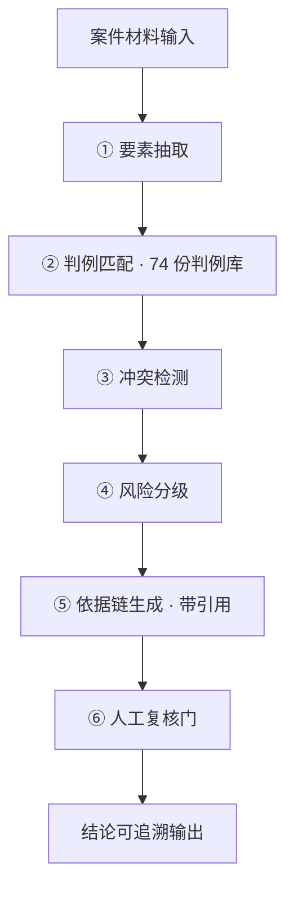

# MedGuard · 医保基金监管智能体

> **模法黑客松 S4 · 医保智能体开发专场 · 决赛入围奖**（中国医疗保障主办，2026 年 7 月）
> 三人团队，我负责**需求分析与系统构建**。


---

## 一句话

把医保基金监管里散落在文件中的**判例规则**，组织成一条**每一步都能追溯到依据**的自动研判链路——从"人工翻法规找依据"变成"秒级给出可复核的结论"。

---

## 背景与任务

医保智能体开发专场的命题指向医保基金监管。这个场景的真实痛点是：

- **规则分散**——监管依据散落在各类文件、判例与口径说明中，人工检索耗时且容易漏
- **判断不可复核**——即使结论正确，**说不出依据是哪一条**，在监管场景里等于不可用
- **人工成本高**——单案研判以"日"计

> ⚠️ **这是黑客松 MVP，不是生产系统。** 下面会写清边界在哪。

---

## 系统架构



## 核心设计：六步可追溯研判链路

```
① 要素抽取  →  ② 判例匹配  →  ③ 冲突检测  →  ④ 风险分级  →  ⑤ 依据链生成  →  ⑥ 人工复核门
```

每一步的产出都携带**引用来源**，最终结论可以逐层回溯到判例库中的具体条目。

| 步骤 | 做什么 | 关键点 |
|:---|:---|:---|
| ① 要素抽取 | 从案件材料中提取可比对的结构化要素 | 要素口径对齐是后面所有步骤的前提 |
| ② 判例匹配 | 在 **74 份判例库**中做检索匹配 | 不是关键词硬匹配，是"要素组合 → 判例适用条件"的判断 |
| ③ 冲突检测 | 识别多判例指向不一致、或事实与依据矛盾的地方 | **冲突不是 bug，是要暴露给人看的信号** |
| ④ 风险分级 | 基于匹配与冲突情况给出分级结论 | 分级依据来自规则，不来自模型"感觉" |
| ⑤ 依据链生成 | 输出完整引用链：结论 ← 判例 ← 原始依据 | ⭐ **这一环是整个系统的价值所在** |
| ⑥ 人工复核门 | 关键结论必须经人确认才生效 | **模型不单独下结论** |

---

## 为什么"可追溯"是设计核心

在黑客松的**现场演示环节**，我向医保主管部门专家完整讲解了这条链路。获得现场肯定的核心不是模型效果，而是：

> **专家能当场看到"这个结论是依据第几条判例得出的"，所以这个结论他敢用。**

一个算法原型要变成能被业务决策者接受的东西，靠的不是模型分数，是**可追溯、可解释、能当场讲清楚**。

---

## 技术实现

- **检索层** — RAG 知识检索，74 份判例构建为可检索知识库，输出带引用来源
- **推理层** — 多步研判链路编排，每步输入输出结构化、可独立评估
- **可靠性层** — 人工复核门 + 冲突显式暴露 + 每次改动自动跑评估用例
- **实现方式** — 以 AI 协作开发（vibe coding）完成 MVP，部署在自有服务器；代码可读性优先，保证后续能被队友接手

> 关于"AI 协作开发"：这个项目的价值恰恰在于**把 AI 输出当原材料、而不是当结论**——这和第 ⑤⑥ 步的设计是同一套方法论。

---

## 局限（写清楚比吹更可信）

| 局限 | 现状 |
|:---|:---|
| **不是生产系统** | 黑客松 MVP，无高可用、无容量规划、无完整审计链 |
| **判例库规模有限** | 74 份，覆盖不了真实监管口径的全部分支 |
| **评估覆盖不足** | 有基础验证用例，但未建立完整的指标基线与回归体系 |
| **要素抽取依赖人工校对** | 复杂案情下抽取准确率是主要瓶颈 |
| **未做权限与分级** | 真实场景下不同角色可见范围不同，这块完全没做 |

---

## 如果重做，我会怎么改

1. **先建评估集**：把判例库切出验证集，每次改动自动跑分——**准确率不可测的 AI 不进生产**
2. **补权限与审计**：谁问了什么、看了哪些依据、谁确认了结论，全部留痕
3. **冲突处理显式化**：冲突不是让模型选一个，而是交给人判断并沉淀回规则库
4. **要素抽取做弱监督**：用人工复核结果反哺抽取，而不是只靠一次性提示
5. **把"解释"做成产品功能**：让使用者随时能点开依据链，而不是只在演示时讲

---

## 团队与角色

| 角色 | 职责 |
|:---|:---|
| **我** | 需求分析与系统构建 · 研判链路设计 · 现场演示与讲解 |
| 队友 A | — |
| 队友 B | — |

---

> 决赛入围奖，2026 年 7 月。证书见上方。
